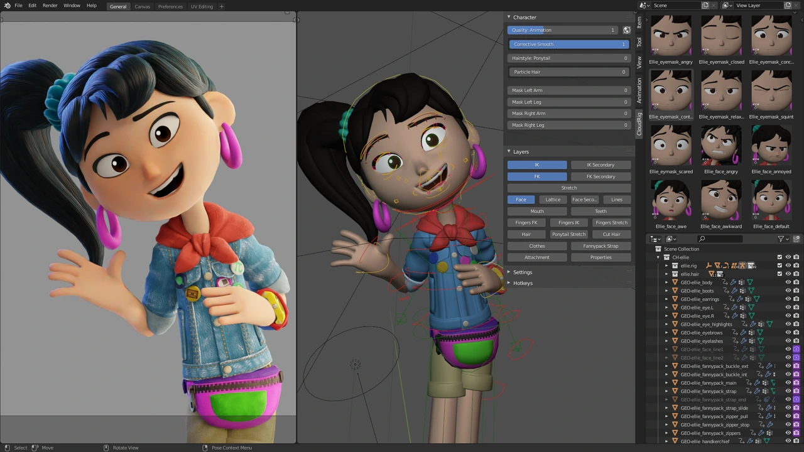
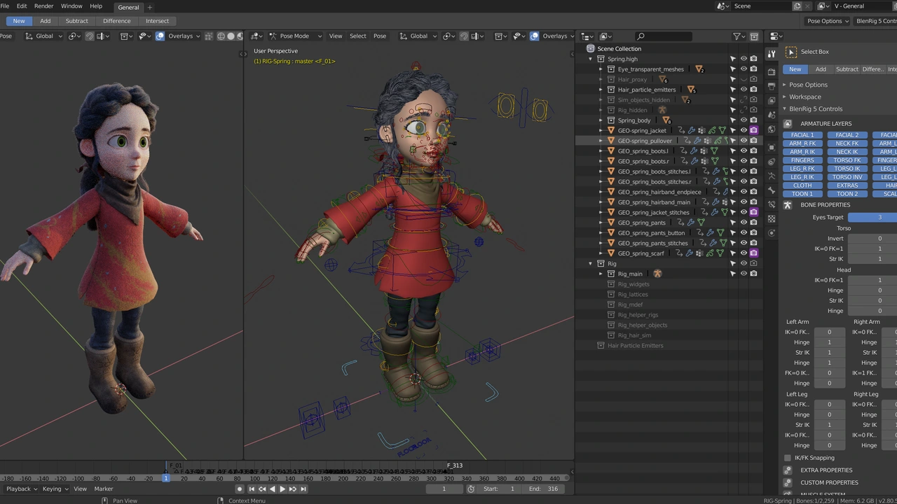
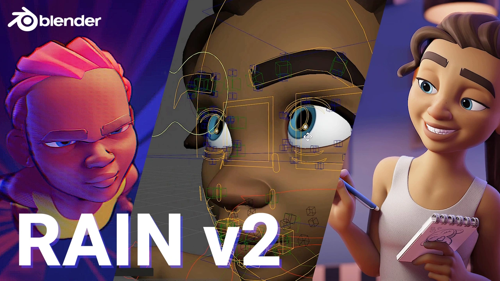

# Ready stylized head research,19 October2026 (#36)

Internal bounded research; not a catalogue for the user or an approved Ruta source. Recommendation: **Ellie** first, retaining our tested Quaternius gait/body. No new sculpting or rig replacement proposed. Original downloaded model files are in /tmp/ruta-head-source-research; hashes and anonymous download probes are in official-source-evidence.json. No account, payment or login used. Requests used ordinary User-Agent/Referer headers; official anonymous download responses200 and payload signatures verified. Initial thumbnails without these headers returned403, then anonymous headers succeeded. Web search fetch402 did not reflect actual official page access; direct anonymous page requests200.

## Recommended: Ellie, Blender Studio

[Official page](https://studio.blender.org/characters/ellie/v1/) · [Direct official blend download](https://studio.blender.org/download-source/files/01/01a02cb0fed8e700b38bdaf7b4ef75df/01a02cb0fed8e700b38bdaf7b4ef75df.blend) · [CC BY4.0](https://creativecommons.org/licenses/by/4.0/).

Strong finished youthful expressive face, sculpted eyelids/brows/mouth and complete production rig. Official preview shows finished geometry and facial poses; dark ponytail and original clothes differ from Ruta. Prefer head/eyes/brows/lashes reuse, then separately assess hair. Actual downloaded compressed blend21,851,981bytes; SHA256 in evidence. Official page warns rig expects Blender3.3–3.6, so current4.5 loading is inspection, not proof all drivers work. Credit proposal: “Ellie, Sprite Fright — Blender Studio / Blender Foundation, CC BY4.0; modified for Ruby Village.” Preserve upstream embedded credits where supplied. Rebinding/extraction/modification requires attribution and a change notice; no share-alike provision.

## Alternate: Spring, Blender Studio

[Official page](https://studio.blender.org/characters/spring/v1/) · [Direct official zip](https://studio.blender.org/download-source/files/1b/1bffff08b464375d842e7da43b4f5293/1bffff08b464375d842e7da43b4f5293.zip) · [CC BY4.0](https://creativecommons.org/licenses/by/4.0/).

Most childlike proportions, large finished eyes and warm storybook face, ready production rig. Dark braided hair/green eyes differ; heavier particle/production setup may complicate extraction. Anonymous download200, ZIP signature and426,238,965byte length checked; full archive not downloaded in this bounded pass. Thumbnail shows actual rig and render. Credit: Spring — Blender Studio / Blender Foundation, CC BY4.0, with modifications noted. Keep as alternate, not an immediate second implementation.

## Alternate: Rain v3 (v2 also available), Blender Studio

[Official v3](https://studio.blender.org/characters/rain/v3/) · [Direct v3 zip](https://studio.blender.org/download-source/files/ee/a7/eea73e55dba1cea31c09848df6a794b2-4.zip) · [Official v2](https://studio.blender.org/characters/rain/v2/) · [CC BY4.0](https://creativecommons.org/licenses/by/4.0/).

Strong finished rounded facial anatomy, blue eyes and brown swept hair. Older-looking face, large eyebrows/nose and shorter hair depart more from Ruta than Ellie/Spring. Actual v3 ZIP67,579,177bytes downloaded and hashed. v2 ZIP199,329,585byte anonymous probe also200. Official Rain page requests Rain Rig credit to Blender Foundation; preserve it and mark adaptation. Preview is official reused v2 presentation, not our render or proof of v3 compatibility. [Official free-rig release notes](https://studio.blender.org/blog/rain-2-rig-released/) confirm production facial controls and free reuse.

All3 official character pages directly link CC BY4.0. [License deed](https://creativecommons.org/licenses/by/4.0/) permits sharing and adaptation with attribution/link/change notice; source redistribution is allowed under those terms. No asset is CC0. Page publishers are not claimed as sole creators. Candidate downloads/visuals do not prove approved likeness or drop-in skeleton compatibility. No integration, regeneration or runtime changes made by this research.
